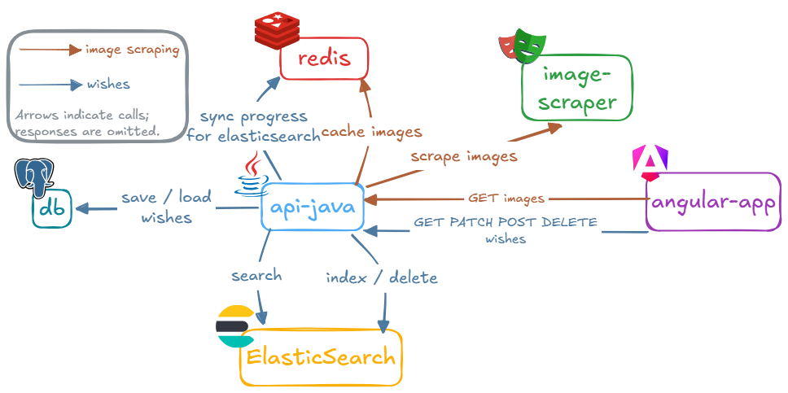

# Wish List Application

A wish list app with Elasticsearch-powered search and online image lookup: a **Java 21 / Spring Boot 3** API, an Angular frontend, and an image-scraper.

| | Tests | Coverage |
|---------|-------|----------|
| **api-java** | [](https://github.com/Merwanel/wish-app-java/actions/workflows/api-java-test-build-push.yaml) | [](https://codecov.io/gh/Merwanel/wish-app-java) |
| **angular-app** | [](https://github.com/Merwanel/wish-app-java/actions/workflows/angular-app-test-build-push.yaml) | [](https://codecov.io/gh/Merwanel/wish-app-java) |
| **image-scraper** | [](https://github.com/Merwanel/wish-app-java/actions/workflows/image-scraper-test-build-push.yaml) | [](https://codecov.io/gh/Merwanel/wish-app-java) |



## Features

- **Wish Management**: Create, update, and delete wishes with names, comments, tags, and images
- **Elasticsearch Search**: Fuzzy search, tag facets, and `<mark>` highlights via `GET /wishes/search`
- **Browsing UI**: Tag facet filters, pagination , two display modes, and several themes persisted in `localStorage`
- **Image Processing**: Uploads are cropped to 200×300 and converted to WebP
- **Online Image Search**: Playwright scraping of web-engines streamed to the UI over SSE through api-java

## How it works

- **Postgres is the source of truth.** Deletes are soft.
- **Seeding**: the first start seeds the db. That seeding phase is skipped during tests 
- **Delta ETL to Elasticsearch.** `WishEtlService` indexes rows whose `updated_at` is at or after a bookmark stored in Redis. Soft-deleted rows are removed from the index. A sync runs:
  - every 5s,
  - once at startup,
  - after each write transaction commits.
- **Search** queries Elasticsearch, then loads the pictures from Postgres for the returned ids.
- **Image search**: `GET /search/{term}` proxies the SSE stream of `image-scraper` (`GET /internal/scrape/{term}`, one image per search engine, run in parallel in worker threads). Complete results are cached in Redis for 1 hour.
- **Redis therefore has two roles**: the ETL bookmark and the scraper-result cache.

## Tech Stack

* **Frontend**: Angular 22, TypeScript, Zod
* **API**: Java 21, Spring Boot 3, Spring Data JPA, Flyway, elasticsearch-java, Redis
* **Sidecar**: image-scraper (Express, Playwright)
* **Infrastructure**: nginx, Redis, PostgreSQL, Elasticsearch, Docker

## Prerequisites

- **Docker Engine** with Compose (infra, production-like stack, and the Java integration tests)
- **JDK 21** and **Maven 3.9+** (only for the local loop and Java tests; the Docker build needs neither)
- **Node.js 22+** and **npm**
- **Chrome/Chromium** for the Angular (Karma) tests
- For real scraping outside Docker: `npm run -w services/image-scraper install:headless-browser` (downloads the Playwright headless browser; not needed for tests)

## Development

From the repo root (Docker Engine required for infra and for Java tests):

```bash
# Local loop: builds shared-schemas, starts Postgres/Redis/Elasticsearch if needed
# (waits until healthy), then runs api-java + image-scraper + Angular together.
npm run dev
```

Local URLs when using `npm run dev`:

- Frontend : http://localhost:4200
- Backend API: http://localhost:3000
- Image scraper: http://localhost:3001
- Elasticsearch: http://localhost:9200

`npm run dev` leaves Postgres, Redis and Elasticsearch running after you stop it (see [Stopping and resetting](#stopping-and-resetting)).


## Production

```bash
npm run dev:docker
# or: docker compose up --build
```

**nginx** serves the Angular build on port 8080 and reverse-proxies the API routes to `api-java:3000`, so that CORS is not a problem.

Published ports:

| Port | Service |
|---|---|
| 8080 | Frontend (nginx) |
| 3000 | api-java |
| 3001 | image-scraper |
| 9200 | Elasticsearch |
| 5432 | PostgreSQL |
| 6379 | Redis |

### Stopping and resetting

```bash
docker compose down        # stop and remove containers (keeps data volumes)
docker compose down -v     # also wipes Postgres/Redis/Elasticsearch volumes
```

## Testing

Root scripts build shared-schemas first when needed, then run suites in parallel (colored prefixes; fail-fast).

```bash
# All modules (Angular needs Chrome/Chromium; api-java needs Docker for Testcontainers)
npm test
npm run test:coverage

# One module
npm run test:angular-app
npm run test:scraper
npm run test:api-java

npm run test:coverage:angular-app
npm run test:coverage:scraper
npm run test:coverage:api-java
```

## CI/CD

One GitHub Actions workflow per module (`.github/workflows/*-test-build-push.yaml`), triggered on pushes to `main` that touch the module:

- **Checks**: tests with coverage uploaded to Codecov (one flag per module, see `codecov.yml`); SpotBugs (api-java); lint, type-check and `npm audit` (angular-app, image-scraper).
- **Images**: after the tests pass, the shared `docker-build-push.yml` workflow builds the image and pushes it to GitHub Container Registry as `ghcr.io/<owner>/wish-app-java-<service>` tagged `latest` and with a CalVer tag (`YYYY.MM.DD-HH.MM.SS`), then runs a Trivy scan.

## Project Structure

```
├── .github/                  # CI workflows and the CalVer action
├── angular-app/              # Angular frontend (+ nginx.conf for the Docker image)
├── api-java/                 # Spring Boot API
├── services/image-scraper/   # Playwright SSE scraper
├── packages/shared-schemas/  # Shared Zod schemas
├── codecov.yml               # Coverage flags per module
├── package.json              # Root npm scripts (dev / test / per-module)
└── docker-compose.yaml
```
